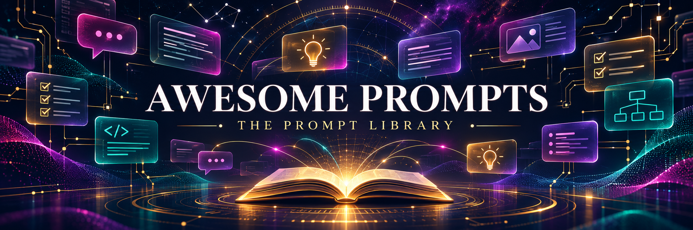

# Awesome Prompts



<details>
<summary><strong>🌍 Languages · Sprachen · 18</strong></summary>

| | |
| --- | --- |
| [ English](../README.md) | [ Deutsch](README.de.md) |
| [ Español](README.es.md) | [ Français](README.fr.md) |
| [ Italiano](README.it.md) | [ Português](README.pt.md) |
| [ Nederlands](README.nl.md) | [ Polski](README.pl.md) |
| [ Türkçe](README.tr.md) | [ 日本語](README.ja.md) |
| [ 한국어](README.ko.md) | [ 中文](README.zh.md) |
| [ العربية](README.ar.md) | [ हिन्दी](README.hi.md) |
| [ Bahasa Indonesia](README.id.md) | [ Tiếng Việt](README.vi.md) |
| [ Українська](README.uk.md) | [ Svenska](README.sv.md) |

</details>

**34 Ressourcen** · [🌐 Awesome Awesome](https://github.com/Supersynergy/awesome-awesome-best-of-repo-lists) · [🧩💬 Partnerliste](https://github.com/Supersynergy/awesome-skills) · [⭐ GitStars](https://gitstars.io/)

**🧭** [📚 Prompt-Sammlungen](#c-libraries) · [🧠 Anleitungen](#c-guides) · [🏛️ Offizielle Cookbooks](#c-cookbooks) · [🎨 Kreative Prompts](#c-creative) · [🧪 Evaluation & Werkzeuge](#c-evaluation) · [📺 Video-Anleitungen](#c-videos)

**🔗**

```text
https://github.com/Supersynergy/awesome-prompts
```

**🧰** [JSONL](../data/sources.jsonl) · [URLs](../data/urls.txt)

<a id="c-libraries"></a>
<details open>
<summary><strong>📚 Prompt-Sammlungen · 9</strong></summary>

- **[prompts.chat](https://github.com/f/prompts.chat)**<br>
  Community-Plattform zum Entdecken und Teilen von Prompts; früher Awesome ChatGPT Prompts.

- **[ai-boost/awesome-prompts](https://github.com/ai-boost/awesome-prompts)**<br>
  Kuratierte Prompts, Frameworks und Fachartikel für LLMs und Agenten.

- **[langgptai/awesome-claude-prompts](https://github.com/langgptai/awesome-claude-prompts)**<br>
  Sammlung von Claude-Prompts.

- **[browser-use/awesome-prompts](https://github.com/browser-use/awesome-prompts)**<br>
  Prompt-Beispiele für Browserautomatisierung; Projektaktivität vor Nutzung prüfen.

- **[GitHub Awesome Copilot](https://github.com/github/awesome-copilot)**<br>
  Community-Prompts, Anweisungen, Agenten und Skills für GitHub Copilot.

- **[0xeb/TheBigPromptLibrary](https://github.com/0xeb/TheBigPromptLibrary)**<br>
  Sammlung von Prompts, Systemprompts und LLM-Anweisungen.

- **[harish-garg/gemini-cli-prompt-library](https://github.com/harish-garg/gemini-cli-prompt-library)**<br>
  Prompt-Vorlagen für Entwicklungsaufgaben mit Gemini CLI.

- **[google-labs-code/jules-awesome-list](https://github.com/google-labs-code/jules-awesome-list)**<br>
  Prompt-Sammlung für den Coding-Agenten Jules.

- **[rockbenben/ChatGPT-Shortcut](https://github.com/rockbenben/ChatGPT-Shortcut)**<br>
  Durchsuchbare Bibliothek für KI-Prompts.

</details>

<a id="c-guides"></a>
<details open>
<summary><strong>🧠 Anleitungen · 8</strong></summary>

- **[Prompt Engineering Guide](https://github.com/dair-ai/Prompt-Engineering-Guide)**<br>
  Anleitungen, Lektionen und Fachartikel zu Prompt- und Context Engineering.

- **[Awesome Prompt Engineering](https://github.com/promptslab/Awesome-Prompt-Engineering)**<br>
  Kuratierte Ressourcen für Prompt Engineering.

- **[NirDiamant/Prompt_Engineering](https://github.com/NirDiamant/Prompt_Engineering)**<br>
  Praxisnotebooks zu Prompting-Techniken.

- **[snwfdhmp/awesome-gpt-prompt-engineering](https://github.com/snwfdhmp/awesome-gpt-prompt-engineering)**<br>
  Kuratierte Ressourcen und Werkzeuge für GPT Prompt Engineering.

- **[brexhq/prompt-engineering](https://github.com/brexhq/prompt-engineering)**<br>
  Historische Praxisnotizen; letzter Push 2023. Aktuelle Anwendbarkeit prüfen.

- **[Awesome-llms-labs/awesome-prompt-engineering](https://github.com/Awesome-llms-labs/awesome-prompt-engineering)**<br>
  Leitfaden zu Prompting-Techniken, Evaluation und Optimierung.

- **[brandonhimpfen/awesome-prompt-engineering](https://github.com/brandonhimpfen/awesome-prompt-engineering)**<br>
  Ressourcen, Fachartikel und Werkzeuge für Prompt Engineering.

- **[microsoft/generative-ai-for-beginners](https://github.com/microsoft/generative-ai-for-beginners)**<br>
  Einführende Lektionen zu generativer KI.

</details>

<a id="c-cookbooks"></a>
<details open>
<summary><strong>🏛️ Offizielle Cookbooks · 4</strong></summary>

- **[OpenAI Cookbook](https://github.com/openai/openai-cookbook)**<br>
  Beispiele und Anleitungen für die OpenAI-API.

- **[Claude Cookbooks](https://github.com/anthropics/claude-cookbooks)**<br>
  Notebooks und Beispiele für Claude.

- **[Gemini Cookbook](https://github.com/google-gemini/cookbook)**<br>
  Beispiele und Anleitungen für die Gemini-API.

- **[GoogleCloudPlatform/generative-ai](https://github.com/GoogleCloudPlatform/generative-ai)**<br>
  Beispiele und Notebooks für Gemini auf Google Cloud.

</details>

<a id="c-creative"></a>
<details open>
<summary><strong>🎨 Kreative Prompts · 6</strong></summary>

- **[Awesome Nano Banana Pro Prompts](https://github.com/YouMind-OpenLab/awesome-nano-banana-pro-prompts)**<br>
  Bildprompt-Beispiele mit Vorschau.

- **[Awesome Image & Video Prompts](https://github.com/ai-boost/awesome-image-video-prompts)**<br>
  Bild- und Videoprompt-Beispiele samt Quellen.

- **[Awesome NotebookLM Prompts](https://github.com/serenakeyitan/awesome-notebookLM-prompts)**<br>
  Community-Prompts für NotebookLM-Folien.

- **[Awesome Seedance 2 Prompts](https://github.com/YouMind-OpenLab/awesome-seedance-2-prompts)**<br>
  Sammlung von Videoprompts.

- **[Evolink-AI/awesome-gpt-image-2-API-Prompts](https://github.com/Evolink-AI/awesome-gpt-image-2-API-Prompts)**<br>
  Prompt- und API-Beispiele für GPT Image 2.

- **[freestylefly/awesome-gpt-image-2](https://github.com/freestylefly/awesome-gpt-image-2)**<br>
  Bildprompt-Beispiele und wiederverwendbare Vorlagen.

</details>

<a id="c-evaluation"></a>
<details open>
<summary><strong>🧪 Evaluation & Werkzeuge · 6</strong></summary>

- **[promptfoo/promptfoo](https://github.com/promptfoo/promptfoo)**<br>
  Tests und Red-Teaming für Prompts, Agenten und Retrieval.

- **[langfuse/langfuse](https://github.com/langfuse/langfuse)**<br>
  Beobachtbarkeit, Evaluation und Prompt-Verwaltung.

- **[openai/evals](https://github.com/openai/evals)**<br>
  Framework und Benchmark-Verzeichnis zur Evaluation von Sprachmodellen.

- **[microsoft/promptflow](https://github.com/microsoft/promptflow)**<br>
  Werkzeuge für Entwicklung und Evaluation von LLM-Anwendungen.

- **[pisterlabs/promptset](https://github.com/pisterlabs/promptset)**<br>
  Forschungsdatensatz mit Entwickler-Prompts.

- **[microsoft/prompty](https://github.com/microsoft/prompty)**<br>
  Werkzeuge zum Erstellen, Verwalten, Debuggen und Evaluieren von LLM-Prompts.

</details>

<a id="c-videos"></a>
<details open>
<summary><strong>📺 Video-Anleitungen · 1</strong></summary>

> Ausgewählte Videos; keine gemessene Trend-Rangliste.

- **[Context Engineering vs. Prompt Engineering](https://www.youtube.com/watch?v=vD0E3EUb8-8)**<br>
  IBM Technology erklärt Prompt- und Context Engineering.

</details>

---

<sub>GitHub-Repository-Daten am 12.11.2026 geprüft. Quellen können sich ändern; aktuellen Status und Lizenz bitte beim jeweiligen Projekt nachsehen.</sub>
