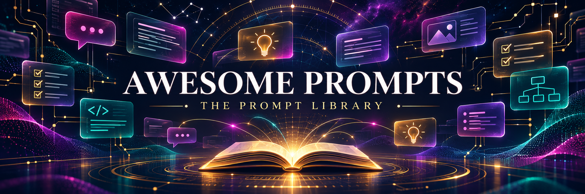

# Awesome Prompts



<details>
<summary><strong>🌍 Languages · Sprachen · 18</strong></summary>

| | |
| --- | --- |
| [ English](../README.md) | [ Deutsch](README.de.md) |
| [ Español](README.es.md) | [ Français](README.fr.md) |
| [ Italiano](README.it.md) | [ Português](README.pt.md) |
| [ Nederlands](README.nl.md) | [ Polski](README.pl.md) |
| [ Türkçe](README.tr.md) | [ 日本語](README.ja.md) |
| [ 한국어](README.ko.md) | [ 中文](README.zh.md) |
| [ العربية](README.ar.md) | [ हिन्दी](README.hi.md) |
| [ Bahasa Indonesia](README.id.md) | [ Tiếng Việt](README.vi.md) |
| [ Українська](README.uk.md) | [ Svenska](README.sv.md) |

</details>

**34 ressources** · [🌐 Awesome Awesome](https://github.com/Supersynergy/awesome-awesome-best-of-repo-lists) · [🧩💬 Liste associée](https://github.com/Supersynergy/awesome-skills) · [⭐ GitStars](https://gitstars.io/)

> Les descriptions des sources sont en anglais.

**🧭** [📚 Bibliothèques de prompts](#c-libraries) · [🧠 Guides](#c-guides) · [🏛️ Recueils officiels](#c-cookbooks) · [🎨 Prompts créatifs](#c-creative) · [🧪 Évaluation et outils](#c-evaluation) · [📺 Vidéos](#c-videos)

**🔗**

```text
https://github.com/Supersynergy/awesome-prompts
```

**🧰** [JSONL](../data/sources.jsonl) · [URLs](../data/urls.txt)

<a id="c-libraries"></a>
<details open>
<summary><strong>📚 Bibliothèques de prompts · 9</strong></summary>

- **[prompts.chat](https://github.com/f/prompts.chat)**<br>
  Community prompt discovery and sharing; formerly Awesome ChatGPT Prompts.

- **[ai-boost/awesome-prompts](https://github.com/ai-boost/awesome-prompts)**<br>
  Prompts and research for LLMs and agents.

- **[langgptai/awesome-claude-prompts](https://github.com/langgptai/awesome-claude-prompts)**<br>
  Claude prompt collection.

- **[browser-use/awesome-prompts](https://github.com/browser-use/awesome-prompts)**<br>
  Prompt examples for browser automation; check the project's activity before relying on it.

- **[GitHub Awesome Copilot](https://github.com/github/awesome-copilot)**<br>
  Community prompts and agent resources for GitHub Copilot.

- **[0xeb/TheBigPromptLibrary](https://github.com/0xeb/TheBigPromptLibrary)**<br>
  Collection of prompts, system prompts and instructions.

- **[harish-garg/gemini-cli-prompt-library](https://github.com/harish-garg/gemini-cli-prompt-library)**<br>
  Prompt templates for development tasks in Gemini CLI.

- **[google-labs-code/jules-awesome-list](https://github.com/google-labs-code/jules-awesome-list)**<br>
  Prompt collection for the Jules coding agent.

- **[rockbenben/ChatGPT-Shortcut](https://github.com/rockbenben/ChatGPT-Shortcut)**<br>
  Searchable AI prompt library.

</details>

<a id="c-guides"></a>
<details open>
<summary><strong>🧠 Guides · 8</strong></summary>

- **[Prompt Engineering Guide](https://github.com/dair-ai/Prompt-Engineering-Guide)**<br>
  Guides and research on prompt and context engineering.

- **[Awesome Prompt Engineering](https://github.com/promptslab/Awesome-Prompt-Engineering)**<br>
  Curated prompt-engineering resources.

- **[NirDiamant/Prompt_Engineering](https://github.com/NirDiamant/Prompt_Engineering)**<br>
  Hands-on notebooks exploring prompting techniques.

- **[snwfdhmp/awesome-gpt-prompt-engineering](https://github.com/snwfdhmp/awesome-gpt-prompt-engineering)**<br>
  Curated resources and tools for GPT prompt engineering.

- **[brexhq/prompt-engineering](https://github.com/brexhq/prompt-engineering)**<br>
  Historical practical notes; last pushed in 2023, so verify current applicability.

- **[Awesome-llms-labs/awesome-prompt-engineering](https://github.com/Awesome-llms-labs/awesome-prompt-engineering)**<br>
  Guide to prompting techniques, evaluation and optimization.

- **[brandonhimpfen/awesome-prompt-engineering](https://github.com/brandonhimpfen/awesome-prompt-engineering)**<br>
  Resources, papers and tools for prompt engineering.

- **[microsoft/generative-ai-for-beginners](https://github.com/microsoft/generative-ai-for-beginners)**<br>
  Introductory generative AI lessons.

</details>

<a id="c-cookbooks"></a>
<details open>
<summary><strong>🏛️ Recueils officiels · 4</strong></summary>

- **[OpenAI Cookbook](https://github.com/openai/openai-cookbook)**<br>
  Examples and guides for the OpenAI API.

- **[Claude Cookbooks](https://github.com/anthropics/claude-cookbooks)**<br>
  Notebooks and recipes for Claude.

- **[Gemini Cookbook](https://github.com/google-gemini/cookbook)**<br>
  Examples and guides for the Gemini API.

- **[GoogleCloudPlatform/generative-ai](https://github.com/GoogleCloudPlatform/generative-ai)**<br>
  Samples and notebooks for Gemini on Google Cloud.

</details>

<a id="c-creative"></a>
<details open>
<summary><strong>🎨 Prompts créatifs · 6</strong></summary>

- **[Awesome Nano Banana Pro Prompts](https://github.com/YouMind-OpenLab/awesome-nano-banana-pro-prompts)**<br>
  Image prompt examples with previews.

- **[Awesome Image & Video Prompts](https://github.com/ai-boost/awesome-image-video-prompts)**<br>
  Image and video prompt examples and sources.

- **[Awesome NotebookLM Prompts](https://github.com/serenakeyitan/awesome-notebookLM-prompts)**<br>
  Community prompts for NotebookLM slides.

- **[Awesome Seedance 2 Prompts](https://github.com/YouMind-OpenLab/awesome-seedance-2-prompts)**<br>
  Video prompt collection.

- **[Evolink-AI/awesome-gpt-image-2-API-Prompts](https://github.com/Evolink-AI/awesome-gpt-image-2-API-Prompts)**<br>
  GPT Image 2 prompt and API examples.

- **[freestylefly/awesome-gpt-image-2](https://github.com/freestylefly/awesome-gpt-image-2)**<br>
  Image prompt examples and reusable templates.

</details>

<a id="c-evaluation"></a>
<details open>
<summary><strong>🧪 Évaluation et outils · 6</strong></summary>

- **[promptfoo/promptfoo](https://github.com/promptfoo/promptfoo)**<br>
  Prompt, agent and retrieval evaluation and red teaming.

- **[langfuse/langfuse](https://github.com/langfuse/langfuse)**<br>
  Observability, evaluation and prompt management.

- **[openai/evals](https://github.com/openai/evals)**<br>
  Framework and benchmark registry for language model evaluation.

- **[microsoft/promptflow](https://github.com/microsoft/promptflow)**<br>
  Tools for developing and evaluating LLM applications.

- **[pisterlabs/promptset](https://github.com/pisterlabs/promptset)**<br>
  Research dataset of developer prompts.

- **[microsoft/prompty](https://github.com/microsoft/prompty)**<br>
  Tools to create, manage, debug and evaluate LLM prompts.

</details>

<a id="c-videos"></a>
<details open>
<summary><strong>📺 Vidéos · 1</strong></summary>

> Vidéos sélectionnées, sans classement des tendances.

- **[Context Engineering vs. Prompt Engineering](https://www.youtube.com/watch?v=vD0E3EUb8-8)**<br>
  IBM Technology explains prompt and context engineering.

</details>

---

<sub>Métadonnées GitHub vérifiées le 12-11-2026. Consultez chaque projet pour son état et sa licence.</sub>
